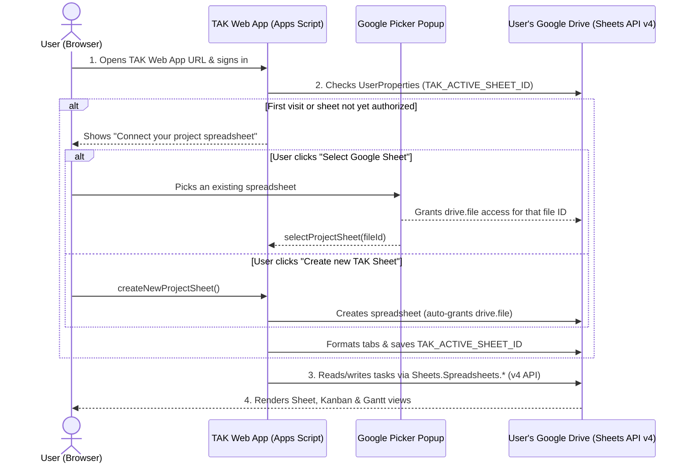

# TAK — How It Works Now & How to Share It (Option 2: Google Picker + `drive.file`)

> [!IMPORTANT]
> **What changed:** TAK now runs as a **User-Accessing Web App** powered by the **Google Picker API** and **Google Sheets API v4** under the single non-sensitive scope `https://www.googleapis.com/auth/drive.file`. Every user's tasks stay inside their own Google Drive spreadsheet—never on a central database.

---

## 1. Architecture Overview



### Key Building Blocks
| Component | File / Location | Role |
| :--- | :--- | :--- |
| **OAuth & Manifest** | [appsscript.json](../appsscript.json) | Executes as `USER_ACCESSING` (`ANYONE`) and requests **only** `https://www.googleapis.com/auth/drive.file`. |
| **GCP Project (`487430968051`)** | Google Cloud Console (`TAK-Project-Tracker`) | Hosts the OAuth consent screen (**In production**), Google Picker API, Google Sheets API, and Google Drive API. |
| **Picker & Onboarding UI** | [Index.html](../Index.html) & [Client.html](../Client.html) | Renders **Select Google Sheet**, **Create new TAK Sheet**, and the header **Switch Sheet** button. |
| **Sheets API v4 Adapter** | [Code.js](../Code.js) & [SharedHost.js](../SharedHost.js) | Replaces `SpreadsheetApp` with `Sheets.Spreadsheets.*` so Google never forces the broad `spreadsheets` scope. |
| **Standalone Browser Demo** | [dist/index.html](../dist/index.html) | 100% offline/local `localStorage` build deployed to GitHub Pages (`https://martingrossman.github.io/TAK/`). |

---

## 2. Publishing Your Shareable `/exec` Link

Apps Script provides two different URLs for your project:

| URL Type | Ends With | Who Can Open It? | Purpose |
| :--- | :--- | :--- | :--- |
| **Test Deployment (`@HEAD`)** | `.../dev` | **Only you** (project owner/editors) | Testing code right after `clasp push` |
| **Published Deployment** | `.../exec` | **Anyone with a Google account** | The link you share with other people |

> [!WARNING]
> Do **not** share the `.../dev` link with other people—Google blocks anyone who is not an editor of the Apps Script project from opening `/dev` URLs. Always share the `.../exec` URL.

### How to Create or Update Your Public `/exec` Link
In Apps Script (or via CLI):
1. **In the Browser**: Open your Apps Script Editor → click **Deploy** → **New deployment** (or **Manage deployments** → edit your existing deployment → **Version: New version**) → click **Deploy** and copy the **`.../exec` Web App URL**.
2. **Or via Terminal (`clasp`)**:
   ```powershell
   clasp.cmd push -f
   clasp.cmd deploy -i <DEPLOYMENT_ID> -d "Option 2 Google Picker release"
   ```
   That updates your existing published `/exec` URL in place so existing bookmarks keep working.

---

## 3. How to Share TAK with People (3 Scenarios)

### Scenario A: Share TAK so each person gets their own private tracker
Use this when you want friends, colleagues, or external users to use TAK for their own projects.
1. Send them your **`.../exec` Web App URL**.
2. They sign in with Google and approve the single permission (*"See, edit, create, and delete only the specific Google Drive files you use with this app"*).
3. On the welcome screen, they click **"Create new TAK Sheet"**.
4. TAK creates a formatted spreadsheet in **their own Google Drive** and remembers it automatically (`TAK_ACTIVE_SHEET_ID`). You cannot see their spreadsheet, and they cannot see yours.

---

### Scenario B: Collaborate with a team on the same project spreadsheet
Use this when multiple people want to work together on the same board/timeline.
1. Open your project spreadsheet in Google Sheets (click the **Sheet ↗** link in TAK's top bar) and click **Share** in Google Sheets to give your teammates **Editor** access.
2. Send your teammates the **`.../exec` Web App URL**.
3. On their first visit, they click **"Select Google Sheet"** (or **Switch Sheet** in the top header if they already had another sheet open).
4. In the Google Picker popup, they select the shared spreadsheet.
5. Choosing the file in Google Picker grants `drive.file` access for their Google account to that shared spreadsheet, and they will see and edit the exact same tasks as you.

> [!TIP]
> Users can switch between multiple project spreadsheets anytime by clicking **Switch Sheet** in the top header bar.

---

### Scenario C: Share a zero-login preview
If someone just wants to try the UI immediately without signing into Google:
- Send them **`https://martingrossman.github.io/TAK/`**
- It loads sample tasks in their browser's `localStorage` with zero sign-in required.
