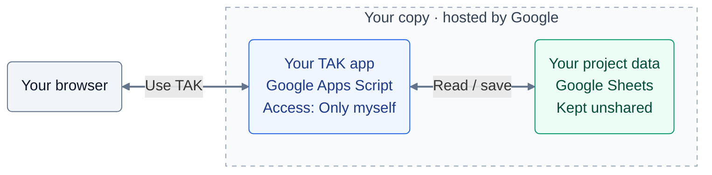
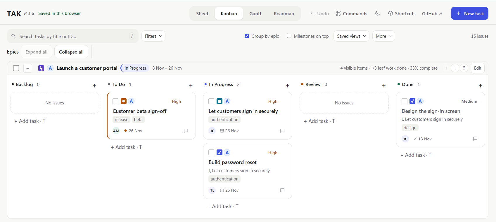
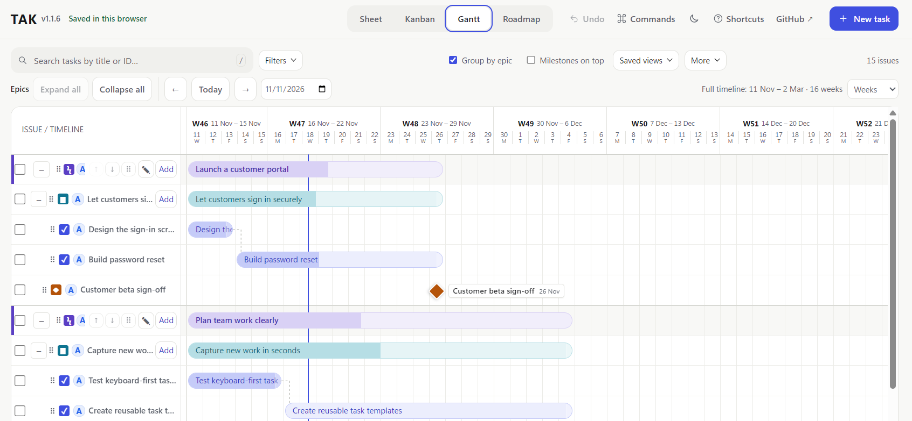
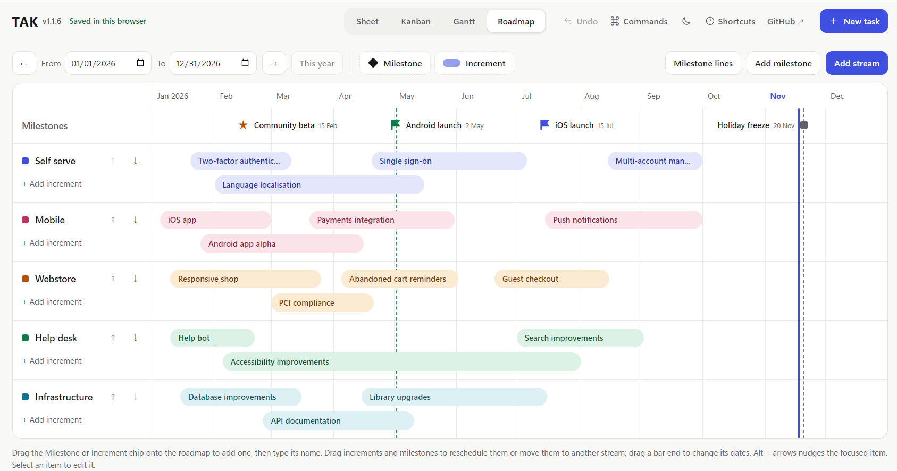

# TAK

**Serverless project tracking, powered by your own Google Sheet.**

A lightweight project tracker with an editable Sheet, a Kanban board, a Gantt timeline, and a Roadmap. **Google Sheets stores your project data; Google Apps Script runs the app.** There is no server or separate database for you to host or maintain.

**You can keep your tracker private.** Copy the starter template to get your own Sheet and Apps Script project. Keep the Sheet unshared and deploy your app with access set to **Only myself** for a personal tracker in your Google account.

[**Try the demo**][demo] · [**Get your own tracker**][starter] · [**Open the hosted app**][hosted]

[Getting started](#start-with-google-sheets) · [Features](#what-you-can-do) · [Shortcuts](#keyboard-shortcuts) · [Development](#project-setup) · [Release notes](CHANGELOG.md) · [Privacy](#privacy)

**Your private TAK, at a glance**



*The personal-template setup: you own the Sheet and app; Google runs the infrastructure.*

**Kanban — move work forward**

[](https://martingrossman.github.io/TAK/#kanban)

**Gantt — plan task dates**

[](https://martingrossman.github.io/TAK/#gantt)

**Roadmap — plan streams and milestones**

[](https://martingrossman.github.io/TAK/#roadmap)

*Click a preview to try that view. The demo needs no sign-in and saves only in this browser. Screenshots show a sample project; they may differ from the latest interface.*

## Choose how to run TAK

| If you want to…                             | Choose                          | Setup                                               | Updates                                          |
| ------------------------------------------- | ------------------------------- | --------------------------------------------------- | ------------------------------------------------ |
| Own the spreadsheet **and** the application | [Starter template][starter]     | Copy it, authorize it, deploy your own web app once | You update your copy's script and deployment     |
| Use Google Sheets without deploying an app  | [Hosted TAK app][hosted]        | Sign in, then create or select a spreadsheet        | Maintained centrally                             |
| Try the interface without signing in        | [Browser demo][demo]            | Open the link                                       | Maintained centrally; data stays in this browser |
| Develop or test TAK locally                 | [Local preview](#project-setup) | Node.js and a local checkout                        | You rebuild the source                           |

**A starter copy has its own Apps Script project.** Its **Open tracker** menu opens that project's web app after you deploy it. The hosted app is a separate option that uses Google Picker to connect a spreadsheet.

Browser-demo and local-preview data do not synchronize with Google Sheets or with each other. Each browser, device and site address has separate browser storage.

## Start with Google Sheets

<a id="optional-full-screen-web-app"></a>

### Your own app from the starter template

This is the route for owning both your Sheet and its attached application. Start in a desktop browser.

1. [Make a copy of the Tracker Template][starter] into your Google Drive.
2. Open **your copy**, refresh the page if necessary, and choose **🔷 TAK → Open tracker**.
3. Review Google's permission request for your copied script. TAK prepares the Sheet and its edit trigger.
4. In **Finish your own TAK app**, click **Open Apps Script**. You can also reach the project through **Extensions → Apps Script** in your Sheet.
5. Choose **Deploy → New deployment**. Next to **Select type**, use the gear icon to choose **Web app**.
6. Set **Execute as: Me** and **Who has access: Only myself**. Click **Deploy** and complete any authorization.
7. Return to your Sheet and choose **🔷 TAK → Open tracker** again. It opens your own app in a new browser tab. Bookmark that tab's `/exec` address for later.

The launcher guides you through setup; it does not create the deployment for you. Keep this personal deployment owner-only. Google's [web-app guide](https://developers.google.com/apps-script/guides/web#deploy_a_script_as_a_web_app) explains the deployment settings.

You own the copied bound script as well as the Sheet. See Google's [bound-script ownership documentation](https://developers.google.com/apps-script/guides/bound#access_to_bound_scripts).

<details>
<summary><strong>First-run help</strong> — permissions, missing menu, or a blocked new tab</summary>

| What you see | What to do |
| --- | --- |
| No **🔷 TAK** menu | Open your copy in a desktop browser, make sure you can edit it, then refresh the Sheet. |
| **Google hasn't verified this app** | Check that you are authorizing the script attached to the copy you created and that you trust its code. If you choose to proceed, use **Advanced → Go to … (unsafe)** when available and review the requested permissions. A personal copy does not inherit another project's OAuth verification. See [Google's explanation](https://developers.google.com/apps-script/guides/client-verification). |
| **Finish your own TAK app** still appears | Complete the Web app deployment in this copy's script, then return to **Open tracker**. Saving source in the editor alone does not create a deployment. |
| No new browser tab opens | Click the visible **Open tracker ↗** link in the dialog. |
| An older copy reports insufficient trigger permissions | Its script may predate the corrected template. Test a fresh starter copy, or have its maintainer update the template package and reauthorize it. Preserve your existing data. |
| A message says this copy points to another tracker | Stop before setup. Use a fresh starter copy; do not repoint or overwrite an existing tracker without checking its data. |

The personal template requests Google Sheets access, permission to show its dialog, and permission to manage its edit trigger. This differs from the hosted app's file-selection permission; see [Privacy](#privacy).

</details>

### Hosted app: no deployment needed

1. [Open the TAK Google Web App][hosted] and sign in.
2. Choose **Create TAK Sheet with sample data**, **Create blank TAK Sheet**, or **Select existing Google Sheet**.
3. For an existing tracker, select it in Google Picker to grant the app access.
4. Bookmark the app tab. Use **Switch Sheet** to connect another project.

The sample option creates 13 items: 3 Epics, 3 Stories and 7 Tasks. The hosted app runs as the signed-in user and uses `drive.file` to work with spreadsheets created through TAK or explicitly selected in Picker.

For collaboration through the hosted app, share the project Sheet with your teammates and have each person select it in TAK. See the [hosted-app sharing guide](docs/OPTION2_SHARING_GUIDE.md).

### Existing copies and updates

- **New starter copies** use the personal deployment flow introduced in `v1.1.6`.
- **Existing copies keep their attached code.** Updating the public template affects future copies only. Older copies may still open the central app or the earlier shared host.
- **Your own app** receives new code only when you update its script. After updating source, use **Deploy → Manage deployments → Edit → New version → Deploy** to update its existing `/exec` address.
- **Hosted-app users** receive centrally published updates when they reload.

A new starter copy is a separate tracker; creating one does not move data out of an older copy. For source-based administration, see [Install TAK from source](docs/INSTALL_FROM_SOURCE.md).

## What you can do

| View | Best for | Everyday actions |
| --- | --- | --- |
| **Sheet** · `1` | Editing and comparing work | Edit cells, sort columns, change parents, reorder siblings, choose visible fields |
| **Kanban** · `2` | Seeing work move forward | Drag between statuses, group by Epic, collapse lanes, edit priorities and assignees |
| **Gantt** · `3` | Planning task dates | Drag to reschedule, resize to set a due date, inspect progress and dependencies |
| **Roadmap** · `4` | Planning streams and milestones | Add increments, place milestones, adjust the visible period, rename and reschedule |

Sheet, Kanban and Gantt share the same tasks. Roadmap has its own streams, increments and milestones; these are separate from task records of type **Milestone**.

<details>
<summary><strong>See the editable Sheet preview</strong></summary>

[](https://martingrossman.github.io/TAK/#sheet)

</details>

### Capture and organize work

- **Title + Enter:** use **+ Add task**, or focus an item and press `T` for a Task or `S` for a Story. The inline composer inherits context and stays open for the next title. `Esc` hides it while retaining an unfinished draft.
- **Details when needed:** use **New task**, `N`, or **Details** for descriptions, dependencies and less-common fields. Saved items expose comments in the compact editor.
- **Hierarchy:** Epics contain Stories; Tasks and Bugs can be nested where the parent rules allow. IDs stay stable when items move. The app rejects self-parenting and cycles.
- **Find and return:** search and filter by properties; save views with their filters, sort, columns and collapse state. Saved views are personal to this browser.
- **Work in batches:** **Paste list** previews up to 100 literal titles. Select items or use **Shift+click** for a visible range, then **Edit selected** or **Delete selected**. Hidden and pending items are excluded. Deletion needs confirmation and has no general Undo.
- **Export:** CSV includes the filtered tasks and their fields, with formula-like text neutralized. CSV import is not included.

<details>
<summary><strong>Moving work and planning dates</strong></summary>

In Sheet, drag the dotted grip to a row's center to change its parent, or to the top/bottom quarter to insert before/after it with the destination's parent. An Epic heading accepts children; a **Drop here to remove parent** target appears during non-Epic drags. The Parent field remains available without dragging.

Up/down controls reorder siblings. Moving a row while a column sort is active returns Sheet to saved rank order. In Kanban, drop on a card to insert before it or on an empty column area to append; moving between Epic lanes also changes the parent.

New Tasks, Stories and Bugs default to today's start date. Explicit dates and cleared dates remain unchanged; Epic schedules follow their descendants. Gantt renders start-only tasks as compact bars: dragging preserves the empty due date, while resizing establishes one.

Use **Expand all**, **Collapse all**, or an individual Epic's **+ / −** controls to fold work. Nonempty capture drafts are retained. Dependencies are validated links, not an automatic scheduling engine: moving a predecessor does not shift successors.

</details>

### Smart quick entry

Type `Prepare release @Martin 5d !high` to set the title, an existing assignee, a five-working-day schedule and High priority. Preview chips show what will be applied.

| Token | Meaning |
| --- | --- |
| `@Martin` or `@"Martin Novak"` | An assignee already used on project issues |
| `!highest`, `!high`, `!medium`, `!low`, `!lowest` | Priority |
| `5d` / `2w` | Five / ten working days, including the start day |
| `due:today`, `due:tomorrow`, `due:2026-12-15` | An explicit deadline |

Workdays are Monday–Friday; holidays are not excluded. Duration advances a weekend start to Monday. Unknown tokens stay in the title; ambiguous or conflicting values need correction. Choose **Keep as title text** or prefix a token with a backslash, such as `\5d`, to keep it literal. Multiline paste does not interpret these tokens.

### Roadmap and themes

Drag the **Milestone** or **Increment** chip onto the grid to add an item, then type its name. Clicking a chip opens the creation dialog. Click an existing name to rename it; double-click, or press Enter on a focused item, for details. `F2` also renames.

Drag bars and milestones to reschedule or change streams; drag a bar end to adjust its dates. **From**, **To**, the navigation arrows and **This year** control the visible period. Milestone icons, colours and optional vertical lines make dates easier to spot.

Google-backed Roadmap data is stored in a separate **Roadmap** tab, created on the first save. The demo uses browser storage. Failed Roadmap saves restore the last saved item with a message.

The sun/moon button switches light and dark themes. Before you make a choice, TAK follows your system setting.

<details>
<summary><strong>Plan notepad and optional Gemini trial</strong></summary>

Open **More → Plan notepad** to plan several lines together. Use `Epic:` headings and `Story:`, `Task:` or `Bug:` lines; choose an existing Epic or create a new one. Add `@Person`, `!high`, `+5d` or `+2w`. Preview, correct and select the proposed items before applying them.

**Prepare for Gemini** downloads your notes and a complete issue snapshot. Upload it to Gemini yourself, copy the supplied prompt, then paste the proposed JSON back into TAK for review. Exported task fields include descriptions, assignees and dependencies; comments, history, settings and spreadsheet identity are omitted. Preparing the download does not send it to Gemini.

The optional **Ask Gemini API** trial needs a separately configured private installation, a `GEMINI_API_KEY` in Script Properties and external-request permission. The standard hosted and template manifests do not include that permission. A configured API request sends project context to Gemini and may incur charges; proposals still require review before application. See the [trial verification notes](TESTING.md#private-gemini-api-trial).

</details>

## Keyboard shortcuts

Use `Ctrl` on Windows/Linux and `Cmd` on macOS where shown. Single-key navigation pauses while typing, during IME composition and in dialogs. It can be disabled through **Shortcuts**.

| Key | Action |
| --- | --- |
| `T` / `S` | Quick Task / Story in the focused context |
| `Shift+T` / `Shift+S` | Task / Story in the compact editor |
| `N` | New issue dialog |
| `E` / `X` | Edit / select the focused issue |
| `P` / `A` / `M` / `D` | Edit priority / assignee / status / due date |
| `/` | Search |
| `1` / `2` / `3` / `4` | Sheet / Kanban / Gantt / Roadmap |
| `Ctrl/Cmd + K` | Commands |
| `Alt` + arrows | Move a focused Roadmap item by a day or between streams; `Shift` changes the horizontal step to a week |

<details>
<summary><strong>Full editing and navigation reference</strong></summary>

Creation and editing shortcuts depend on the focused control:

| Where / focus | Key | Action |
| --- | --- | --- |
| Quick-add title, including Kanban column entry | `Enter` | Submit and leave an empty, focused composer ready for another title; Esc closes it. |
| Quick-add title | `Shift+Enter` | Submit and leave an empty, focused composer ready for another title. |
| Ghost Capture, from any control | `Esc` | Hide capture, retain the unfinished draft, and restore originating focus. Discard draft is a secondary action. |
| Focused row grip, card or Gantt label | `↑` / `↓` | Navigate visible items; Kanban `←` / `→` changes column without changing data. |
| Issue dialog title | `Enter` | Submit the issue form. |
| Issue dialog | `Ctrl/Cmd + Enter` | Submit the issue form, including from the description. |
| Issue dialog | `Tab` / `Shift + Tab` | Move forward/backward through controls within the dialog. |
| Issue dialog | `Esc` | Request closing; unsaved changes may require confirmation. |
| Sheet editable cell | `Tab` / `Shift + Tab` | Commit the cell change and move to the next/previous editable cell. |
| Sheet text, number, or date input | `Enter` / `Shift + Enter` | Commit the change and move down/up in the same column. |
| Sheet text, number, or date input | `Esc` | Cancel the unsent edit and focus the row grip; T/S is then available. |
| Kanban assignee input | `Enter` / `Esc` | Submit the assignee change / cancel the unsent change. |
| Focused Kanban card | `Enter` or `Space` | Open the issue editor. |
| Focused Kanban card | `Alt + ↑` / `Alt + ↓` | Reorder the card within its current column and lane. |
| Focused Kanban card | `Alt + ←` / `Alt + →` | Move to the previous/next status column, keeping its parent. |
| Sheet dotted row grip | `Alt + ↑` / `Alt + ↓` | Reorder siblings while keeping the same parent. |
| Gantt task label or bar | `Enter` or `Space` | Open the issue editor. |
| Gantt task label or Epic lane heading | `Alt + ↑` / `Alt + ↓` | Reorder siblings. |
| Gantt task label | `Alt + ←` / `Alt + →` | Remove the parent / nest under the previous sibling when that relationship is valid. |
| Gantt label/timeline divider | `←` / `→` | Narrow/widen the label area by 10 pixels. |
| Commands search | `Enter` / `↓` | Run the first result / focus the first result. |
| Focused Commands result | `↑` / `↓` | Move between results; Up from the first returns to search. |
| Commands dialog | `Esc` | Close Commands and restore focus. |

Use `Tab` to reach cards, row grips, task labels, and other controls before applying their shortcuts. **Commands** also opens the palette with mouse or touch. **Shortcuts** starts with five capture actions (T, S, Enter, Shift+Enter, Esc); expand Navigate and find, Edit focused work, the view-specific groups, or Full reference and preferences for everything else, including the single-key preference.

</details>

## Saving and collaboration

Pending work appears immediately with **Saving…** or **Queued…**. Wait for confirmation before treating a change as saved. A failed quick-add remains available for retry; pending items cannot yet be edited, dragged or used as parents.

Task edits use revision checks. When a conflict is detected, **Compare with latest** helps inspect the difference; automatic merging is not implemented. **Undo** covers supported acknowledged edits, moves, scheduling, bulk edits and duplication, subject to revision checks. It does not provide general recovery for deletion, creation or comments.

In team mode, the app refreshes periodically while visible and not editing, or when you choose **Refresh**. This is not live simultaneous editing. Direct Sheet edits do not take the application's script lock; avoid editing the same row at precisely the same time through both interfaces.

| Setup | Collaboration |
| --- | --- |
| Hosted app | Share the Sheet in Google, then each teammate selects it through Picker |
| Personal template deployed as **Only myself** | Owner-only web app; sharing the Sheet does not change deployment access |
| Browser demo or local preview | Local to that browser and site address |

Google-backed saves can take several seconds. The response-time goals in the [MVP requirements](docs/PRODUCT_REQUIREMENTS_MVP.md) are targets, not guarantees for every deployment or dataset. Known recovery and reliability follow-ups are tracked in the [backlog](docs/BACKLOG.md).

<details>
<summary><strong>Personal mode and advanced storage</strong></summary>

A private installation can use `enablePersonalTrackerMode` to disable detailed history and automatic polling; `enableTeamTrackerMode` restores them. These functions change server behaviour, not Google sharing. The optimized personal save path additionally needs the Advanced Sheets service; the standard starter-template package does not enable it.

Normal template use requires no schema migration. The legacy `Issues` layout and the optional v2 `Tasks` / `Projects and Epics` layout are distinct storage paths. V2 activation, rollback and authorization configuration require a backed-up test workbook and the [administration guide](docs/INSTALL_FROM_SOURCE.md). Spreadsheet sharing remains a separate permission surface.

</details>

## Sheet columns

The default task register is **Issues**. Keep its header names and order intact; the app's **Title** field is the Sheet's **Summary** column. IDs, revision-related timestamps and ordering fields are managed by TAK.

<details>
<summary><strong>All 21 task columns</strong></summary>

| Column | Field | Meaning |
| --- | --- | --- |
| A | ID | Generated `PRJ-1`, `PRJ-2`, etc. |
| B | Type | Epic, Story, Task, Bug, Milestone |
| C | Parent ID | Optional parent issue ID |
| D | Summary | Required, up to 250 characters in the app |
| E | Description | Context, acceptance criteria, and links as text |
| F | Status | Backlog, To Do, In Progress, Review, Done |
| G | Priority | Highest, High, Medium, Low, Lowest |
| H | Assignee | Name or email; blank means unassigned |
| I | Reporter | Name or email |
| J | Start Date | Optional date, displayed as YYYY-MM-DD |
| K | Due Date | Optional date, on or after start |
| L | Completed Date | Generated when moving to Done; cleared on reopening |
| M | Estimate (h) | Nonnegative hours |
| N | Time Spent (h) | Nonnegative hours |
| O | Progress (%) | 0–100; Done sets 100; reopening a completed issue resets 100 to 0 |
| P | Labels | Comma-separated text |
| Q | Sprint | Optional sprint name |
| R | Dependencies | Comma-separated existing issue IDs; cycles prohibited in the app |
| S | Created At | Generated timestamp |
| T | Updated At | Generated timestamp |
| U | Order | Numeric board sort order; normally managed by the app |

</details>

New template copies install an edit trigger during setup so native edits can receive defaults and validation. Enter a task's Summary in column D and fill its other properties. Dates are stored as Sheet dates; the app exchanges date-only strings. Roadmap items use their own tab and do not change these task rows.

## Project setup

Local development requires **Node.js 20+**. The standalone app uses dependency-free HTML, CSS and JavaScript.

```sh
git clone --branch implement_mvp https://github.com/martingrossman/TAK.git
cd TAK
npm ci
npm run build
npm start
```

Open [the local preview](http://127.0.0.1:4180). On Windows PowerShell, use `npm.cmd` if `npm` is blocked by script policy. Set `PORT` to use another port.

You can also open `dist/index.html` directly or serve that file from an HTTPS static host. Local browser storage is not a durable backup; export task CSV when needed.

| Command | Purpose |
| --- | --- |
| `npm run build` | Generate `CoreScript.html`, `Version.js` and `dist/index.html`; validate JavaScript |
| `npm test` | Run Node tests |
| `npm run check` | Build and run Node tests |
| `npm run test:browser` | Run Playwright tests in Microsoft Edge |
| `npm start` | Serve the preview on port 4180 by default |
| `npm run stop` | Stop the local preview server |

Direct view links use `#sheet`, `#kanban`, `#gantt`, `#roadmap`, or their `?view=…` equivalents.

## Development and verification

Run `npm run check` after a change. It validates the build and exercises model, storage, setup, conflict and recovery behavior with local fixtures.

For browser checks, install Microsoft Edge if needed with `npx playwright install msedge`, then run the relevant specs from [TESTING.md](TESTING.md). The current Playwright configuration uses Edge, a local server on port 4587 (`SHEETFLOW_TEST_PORT` overrides it), and retained traces on failure.

Passing local tests does not verify Google authorization, a live deployment or real Sheet permissions. Verify those separately on a disposable test copy. Test histories in the documentation describe the versions and dates recorded there.

## Publishing and updates

Every web app release also updates the starter template's attached script to the same version. Existing user copies still keep their own code.

| Destination | What a release updates |
| --- | --- |
| GitHub Pages | The browser demo; its workflow runs on pushes to `implement_mvp` |
| Hosted Google web app | The version behind its existing `/exec` URL |
| Public starter template | Code inherited by **future** copies |
| An existing personal copy | Only when its owner installs code and updates that copy's deployment |

Maintainers follow [docs/RELEASE.md](docs/RELEASE.md): build and test, version and document the change, test `/dev`, obtain the owner's production approval, update the existing production deployment, then update the public template and verify a fresh copy.

The repository root targets the hosted app. Template code and its separate permissions are packaged with `node scripts/stage-package.mjs template`. Verify the destination project before any upload; a private test copy and the public starter are different targets.

`npm run release` is for a person at an interactive terminal. `npm run clasp:info` reads deployment information. Neither is part of the local preview workflow. Git publication, GitHub Pages and Apps Script deployment are separate actions.

The source version lives in `package.json`; the build generates the badge and `Version.js`. A local version bump does not change a deployed web app. See [CHANGELOG.md](CHANGELOG.md) for changes and [the release guide](docs/RELEASE.md) for versioning and rollback.

## How it works

TAK shares a model and interface between browser storage and Google Sheets. It does not use a separate TAK database. Sheet, Kanban and Gantt read the same issue collection; Roadmap keeps a separate plan.

<details>
<summary><strong>Source map</strong></summary>

| Files | Responsibility |
| --- | --- |
| `Index.html`, `Styles.html`, `Client.html` | Interface, views, interactions and browser persistence |
| `Core.js` | Shared model, validation, dates, CSV and sample data |
| `Code.js`, `PersonalBatch.js` | Apps Script entry points, Sheets access, setup and saves |
| `FullScreen.html`, `Help.html`, `QuickAdd.html` | Sheet launcher, help and quick-add dialogs |
| `SharedHost.js`, `Connection.html` | Earlier shared-host mode and connection helpers |
| `Roadmap.js` | Roadmap storage and revision checks |
| `Schema.js`, `Migrations.js`, `Environment.js`, `Repository.js` | Schema, environment selection and optional v2 storage |
| `Authorization.js`, `Settings.js`, `History.js`, `Ordering.js`, `Comments.js` | Access checks, settings, history, ordering and comments |
| `scripts/build.mjs` | Generate browser and version outputs |
| `scripts/google-package.mjs`, `scripts/stage-package.mjs` | Package the personal template or earlier shared host |
| `scripts/release.mjs`, `scripts/clasp-info.mjs` | Human-run release helper and deployment information |
| `tests/`, `e2e/` | Node fixtures and browser tests |

`CoreScript.html`, `Version.js` and `dist/index.html` are generated files; edit their source and rebuild.

</details>

TAK retains `sheetflow.` browser keys, `SHEETFLOW_` properties and `SheetFlow` namespaces for compatibility. It is a standalone tracker, not an Atlassian Jira integration.

## Privacy

**Your own template copy can be a private personal tracker.** Keep the copied Sheet unshared and set the app's **Who has access** to **Only myself** when deploying. Sheet sharing and web-app access are separate settings: check both. Google hosts the Sheet and Apps Script application; you control access to your copy.

| Where you use TAK | Data and permissions |
| --- | --- |
| Browser demo / local preview | Tasks and preferences are stored in this browser's `localStorage` for that address |
| Hosted Google app | Tasks are in your Sheet; `drive.file` grants access to files created through the app or explicitly selected in Picker |
| Your template copy | Tasks are in the copied Sheet. Its script requests broader `spreadsheets` access, `script.container.ui` for dialogs and `script.scriptapp` for triggers |

Google-backed use also keeps UI preferences and recovery drafts in the browser. Owning a copy does not restrict the OAuth grant to that one spreadsheet: review its broader Sheets permission when authorizing it.

The normal tracker has no separate third-party task database. If you choose to upload a planning export to Gemini, or use a separately configured Gemini API trial, the exported task content is shared with that service. Review it first.

Contact: [martin.grossman@gmail.com](mailto:martin.grossman@gmail.com).

## Further reading

- [Changelog](CHANGELOG.md) — changes by version.
- [Testing guide](TESTING.md) — targeted checks and recorded results.
- [Hosted-app sharing guide](docs/OPTION2_SHARING_GUIDE.md) — Google Picker and team access.
- [Source installation](docs/INSTALL_FROM_SOURCE.md) — advanced administration.
- [Release guide](docs/RELEASE.md) — production, template updates and rollback.
- [MVP requirements](docs/PRODUCT_REQUIREMENTS_MVP.md), [UX specification](docs/UI_UX_DESIGN_SPEC.md) and [future roadmap](docs/FUTURE_ROADMAP.md) — product contracts and planned work, not a list of completed features.
- [Earlier shared-host design](docs/SHARED_APP_DESIGN.md) — historical architecture used by some older copies.

[demo]: https://martingrossman.github.io/TAK/
[starter]: https://docs.google.com/spreadsheets/d/1HaBavwDoxemGXhrAPas_9ppTmRmHAHOlMc5NSjOJ2iE/copy
[hosted]: https://script.google.com/macros/s/AKfycbzVyzDi_IaUvTDZGazF8k4nEcWxzdu5idr8oTrXveV8B7cQ9Af_uSszXcXelkBxb5r_/exec
