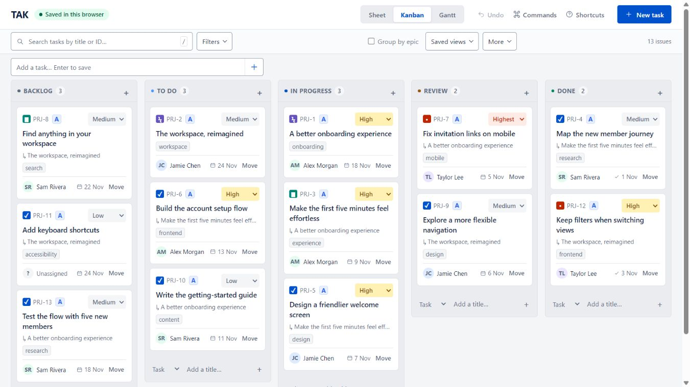
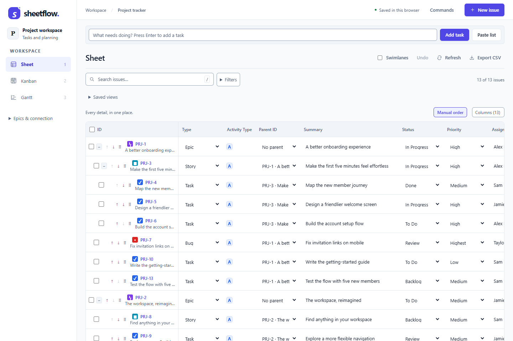
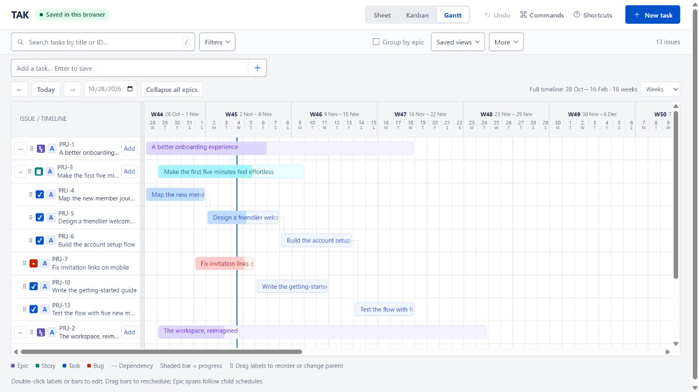

# TAK

A lightweight project tracker with an editable Sheet, a drag-and-drop Kanban board, and an interactive Gantt timeline. Capture tasks with just a title, edit priorities and assignees directly, and plan dates in one workspace.

### [▶ Open live demo](https://martingrossman.github.io/TAK/)

**No sign-in needed.** The demo saves changes in your browser only. It does not sync to Google Sheets or other people.

## Start with Google Sheets

1. Sign in to Google and [make a private copy of the TAK starter template](https://docs.google.com/spreadsheets/d/1HaBavwDoxemGXhrAPas_9ppTmRmHAHOlMc5NSjOJ2iE/copy).
2. Open your copy. If the menu has not appeared yet, reload the sheet. Choose **🔷 TAK → Open tracker**.
3. Authorize with the Google account that owns your copy if prompted. TAK opens in a full browser tab, starting in Kanban. Switch to Sheet or Gantt from the top bar. If your browser blocks the new tab, click **Open tracker ↗** in the small launcher.

Your copy starts with three example Epics, six Stories, and twelve Tasks/Bugs. Replace or remove the examples as you make the project your own. Your tasks stay in **your Google spreadsheet**. You do not need to publish an app, copy code, or share your sheet publicly. Bookmark the opened TAK tab for later, including on your phone.

The shared app requests Google Sheets access and your email identity, then runs using your own Google permissions. Google may show an **unverified-app warning** during this initial release; Google verification is not yet complete. The [browser demo](https://martingrossman.github.io/TAK/) remains separate and saves only in your browser. Developers attaching TAK to a different blank spreadsheet can use the [advanced source-install guide](docs/INSTALL_FROM_SOURCE.md).

[**Kanban board**](https://martingrossman.github.io/TAK/#kanban) · [**Editable Sheet**](https://martingrossman.github.io/TAK/#sheet) · [**Gantt timeline**](https://martingrossman.github.io/TAK/#gantt) · [**Keyboard shortcuts**](#keyboard-shortcuts) · [**Local setup**](#project-setup)

[](https://martingrossman.github.io/TAK/#kanban)

| Edit work in Sheet | Plan dates in Gantt |
| --- | --- |
| [](https://martingrossman.github.io/TAK/#sheet) | [](https://martingrossman.github.io/TAK/#gantt) |

*Screenshots show the standalone app with sample data. Click a preview to open that view in the live demo.*

## Keyboard shortcuts

Use `Ctrl` on Windows/Linux or `Cmd` on macOS where shown. Navigation shortcuts work when focus is outside an input, text area, select, or editable text, and no dialog is open. They pause during IME text composition. In Sheet, press Escape to leave a text cell for its row grip; elsewhere, use Tab to focus a card or control.

| Key | Action |
| --- | --- |
| `T` / `S` | Quick task / story in the focused context. |
| `Shift+T` / `Shift+S` | Task / story with the compact editor. |
| `N` | Open the compact New issue dialog. |
| `E` / `X` | On a focused issue, open its editor / toggle selection. |
| `P` / `A` / `M` / `D` | On a focused issue, edit priority / assignee / status / due date. |
| `/` | Focus search. |
| `1` / `2` / `3` | Switch to Sheet / Kanban / Gantt. |
| `Ctrl/Cmd + K` | Open Commands to find an issue, create one, switch views, or focus search. |

Creation and editing shortcuts depend on the focused control:

| Where / focus | Key | Action |
| --- | --- | --- |
| Quick-add title, including Kanban column entry | `Enter` | Submit and leave an empty, focused composer ready for another title; Esc closes it. |
| Quick-add title | `Shift+Enter` | Submit and leave an empty, focused composer ready for another title. |
| Ghost Capture, from any control | `Esc` | Hide capture, retain the unfinished draft, and restore originating focus. Discard draft is a secondary action. |
| Focused row grip, card or Gantt label | `↑` / `↓` | Navigate visible items; Kanban `←` / `→` changes column without changing data. |
| Issue dialog title | `Enter` | Submit the issue form. |
| Issue dialog | `Ctrl/Cmd + Enter` | Submit the issue form, including from the description. |
| Issue dialog | `Tab` / `Shift + Tab` | Move forward/backward through controls within the dialog. |
| Issue dialog | `Esc` | Request closing; unsaved changes may require confirmation. |
| Sheet editable cell | `Tab` / `Shift + Tab` | Commit the cell change and move to the next/previous editable cell. |
| Sheet text, number, or date input | `Enter` / `Shift + Enter` | Commit the change and move down/up in the same column. |
| Sheet text, number, or date input | `Esc` | Cancel the unsent edit and focus the row grip; T/S is then available. |
| Kanban assignee input | `Enter` / `Esc` | Submit the assignee change / cancel the unsent change. |
| Focused Kanban card | `Enter` or `Space` | Open the issue editor. |
| Focused Kanban card | `Alt + ↑` / `Alt + ↓` | Reorder the card within its current column and lane. |
| Focused Kanban card | `Alt + ←` / `Alt + →` | Move to the previous/next status column, keeping its parent. |
| Sheet dotted row grip | `Alt + ↑` / `Alt + ↓` | Reorder siblings while keeping the same parent. |
| Gantt task label or bar | `Enter` or `Space` | Open the issue editor. |
| Gantt task label or Epic lane heading | `Alt + ↑` / `Alt + ↓` | Reorder siblings. |
| Gantt task label | `Alt + ←` / `Alt + →` | Remove the parent / nest under the previous sibling when that relationship is valid. |
| Gantt label/timeline divider | `←` / `→` | Narrow/widen the label area by 10 pixels. |
| Commands search | `Enter` / `↓` | Run the first result / focus the first result. |
| Focused Commands result | `↑` / `↓` | Move between results; Up from the first returns to search. |
| Commands dialog | `Esc` | Close Commands and restore focus. |

Use `Tab` to reach cards, row grips, task labels, and other controls before applying their shortcuts. **Commands** also opens the palette with mouse or touch. **Shortcuts** starts with five capture actions (T, S, Enter, Shift+Enter, Esc); expand Navigate and find, Edit focused work, the view-specific groups, or Full reference and preferences for everything else, including the single-key preference.

### Ghost Capture in all three views

Focus an Epic, Story, task, row grip, card, or Gantt label and press **T** for a task or **S** for a story. **Ghost Capture** appears as a temporary Sheet row, a Kanban card in the intended lane/status, or a Gantt label row under its parent—not an overlay on the timeline. Visible **+ Add task** controls open the same flow. The generous title field, searchable parent breadcrumb, quiet **Create ↵**, and **Details** are primary; Type, Status, and **Discard draft** live in secondary options. On phones the compact composer stays reachable above the keyboard.

**Enter**, **Shift+Enter** and **Create** submit and keep an empty composer focused for repeat capture. Capture remains open until Escape; acknowledgement must never interrupt the next draft or steal focus after navigation. Pending work cannot be edited, dragged, or used as a parent. **Shift+T/S** or **Details** opens the compact editor with the same defaults. Escape hides capture but retains unfinished text for resume.

**Collapse all** in Sheet, grouped Kanban or Gantt—and an individual Epic's **−** control—also closes an empty capture box so it cannot keep an Epic open. Nonempty titles (including smart-entry tokens) and pasted drafts remain open and unchanged.

Tasks go inside a focused Epic/Story; on an existing Task/Bug they become siblings. Stories go into the containing Epic. With no focused item, one selected row supplies context, followed by the selected Epic filter, otherwise **No parent**. Hover never chooses a parent. The parent picker supports pointer or keyboard search and legal choices only.
In every grouped view, clicking an Epic heading selects the task context without changing its open/closed state; a restrained marker identifies the selected Epic, while keyboard focus rings remain visible. `T` and contextual Add controls inherit that Epic. Choosing a parent in capture or successfully changing it in the issue dialog moves context to its containing Epic; removing the parent clears it. Parent-driven focus opens collapsed destination Epic/Story ancestors and keeps capture reachable with typing focus retained. Manual heading selection never changes collapse state. The left **+ / −** independently expands or collapses one Epic. Sheet, grouped Kanban and Gantt provide separate **Expand all** and **Collapse all** controls; Sheet also has an Epic-level **+ Task** button.

Double-click a task title, Sheet row/grip, or Epic heading to open details in any view. Single-click Epic headings still select task context without folding the lane; use +/− to fold it. Kanban cards also retain single-click opening. Selection checkboxes, inline property controls and Add buttons keep their own actions.

To remove an activity classification, open **More options → Metadata → Activity type → No activity type**, or choose it in **Edit selected**. No activity badge is shown in Sheet, Kanban or Gantt. You can assign a type again later; existing classifications and the configured creation default are unchanged. The explicit `none` value uses existing storage, with no schema migration.

Saved issues show **Comments** directly in the compact dialog: read, add or edit a comment without opening More options. Expanding and returning to compact preserves a typed comment; child issues and duplication controls remain in More options.


Status inherits the focused issue in Sheet/Gantt and the exact Kanban column for keyboard or visible Add. New work is ranked immediately after a focused sibling when that ordering scope is valid. New items otherwise append to their inherited scope. Priority defaults to Medium, start date to today, due date remains empty, and every queued submission freezes its own defaults, rank, and operation ID.

New Tasks, Stories and Bugs default their start date to today across capture, the editor, Paste list, the Sheets sidebar and native Sheet creation. Browser entry uses the local calendar day; server/native entry uses the spreadsheet timezone. Explicit dates or cleared dates remain unchanged, as do existing tasks. Epics keep derived dates. Plain creation can start on a weekend; only a working-day duration advances that start to Monday. Submitted dates remain frozen for retries.

Pasting multiple lines into an empty Ghost Capture opens an editable preview for up to 100 titles. Each non-empty line becomes one work item in the same context and order. Technical title text is never interpreted as commands or natural language.

From a focused issue, use **P**, **A**, **M**, or **D** for anchored priority, assignee, status, or due-date editing; **E** opens details and **X** toggles selection. The same actions are discoverable through visible controls and Commands. Single-key shortcuts can be disabled in Shortcuts; they never run while typing, during IME composition, or in dialogs.

### Smart quick entry

Type `Prepare release @Martin 5d !high` in single-title capture. With a known Martin, this creates **Prepare release**, assigned to Martin, with High priority and a five-working-day schedule.

| Token | Meaning |
|---|---|
| `@Martin` or `@"Martin Novak"` | Existing assignee; choose a suggestion when names are ambiguous |
| `!highest`, `!high`, `!medium`, `!low`, `!lowest` | Priority |
| `5d` | Five working days, including the start day |
| `2w` | Ten working days |
| `due:today`, `due:tomorrow`, `due:2026-12-15` | Explicit deadline, not duration |

Workdays are Monday–Friday. A Monday start plus `5d` ends Friday; a Friday start ends the following Thursday. Weekend starts advance to Monday. Holidays are not excluded. Duration sets the existing start/due fields; later Gantt edits still use their existing calendar-day behavior.

Preview chips show the resolved values before creation. Keep typing freely: the raw title stays editable. Choose **Keep as title text** for a recognized token, or prefix it with a backslash (`\5d`, `\!high`) to keep it literal. Unknown tokens and email addresses remain title text. Conflicting priorities, ambiguous names, invalid dates/durations or disagreeing duration/deadline combinations require correction before creation.

At `@`, use arrows and Tab/Enter or click to choose an assignee. Enter accepts an open suggestion first; the next Enter creates and keeps capture ready. Escape dismisses suggestions first, then closes capture while preserving the draft. Details receives the parsed title and values. Submitted values are frozen for retry; metadata does not carry into the next title.

Assignee suggestions currently come from names already used on project issues; quick entry does not create people or load a separate Team directory.

Smart syntax applies only to single-title capture. Multiline paste remains a literal-title batch.


### Select, modify or delete multiple items

- Select an item, then **Shift+click** another to select the visible range in Sheet, Kanban or Gantt. Individual selection controls and **X** on focused work also support keyboard/touch use.
- The selection bar offers **Edit selected**, **Delete selected** and **Clear selection**. Actions support up to 100 items; hidden/collapsed items and pending creations are excluded.
- **Edit selected** changes one common field across the selected set: status, assignee, priority, Epic, activity type, start date or due date. Other values stay unchanged; existing revision checks and bulk-edit Undo apply.
- **Delete selected** requires confirmation and has no general Undo. Include related children/dependants explicitly: any unselected item referencing the selection blocks the entire deletion. No automatic cascade.
- An uncertain deletion retains its original operation identity for retry. Items disappear only after acknowledgement; a stale revision or validation error is shown instead of silently overwriting newer work.


## Project setup

Requires Node.js 20 or newer for the development tools and an installed Microsoft Edge for browser tests. The built app has no external runtime dependencies; Playwright is a development-only dependency.

Clone the repository and enter the project directory:

```sh
git clone https://github.com/martingrossman/TAK.git
cd TAK
```

Run the build and test checks before making changes:

```sh
npm ci
npm run check
```

Start the local browser demo:

```sh
npm start
```

Open **http://127.0.0.1:4180**. Set `PORT` to use a different port. On Windows PowerShell with script execution disabled, use `npm.cmd` and `clasp.cmd` in place of `npm` and `clasp`.

You can also open `dist/index.html` directly, or upload that single file to an HTTPS static host. The standalone version starts with a clearly labeled sample project and saves changes in that browser's local storage. It does **not** sync to Google Sheets or other users. Browser storage can be cleared by the browser; export CSV to keep a portable copy. Use the Google Sheets setup below for persistent spreadsheet storage.

Saved views capture the current filters, view, sort, visible columns, swimlane setting, and collapse state. They are personal to the current browser and do not sync to other users.

In **Sheet**, drag the dotted row grip to a row's **center** to make that row the new parent, or to an **Epic header** to move into that Epic. Drop at the **top/bottom quarter** of a row to insert before/after it and adopt its parent. A **Drop here to remove parent** target appears during non-Epic drags. Valid destinations highlight; invalid parent types, self-drops and cycles are blocked. Stories belong under Epics; Tasks/Bugs can also nest under other Tasks/Bugs. The Parent field/editor remains available as a keyboard alternative.

The up/down buttons and Alt + Up/Down keep the same parent and reorder siblings regardless of status. Dragging or using move controls in a column-sorted view automatically returns the Sheet to saved rank order; no separate mode button is shown. Drag moves expand the destination group, retain descendant links and preserve status, dates, dependencies and hidden siblings. Undo reverses the saved move. Inline Parent selects retain the current nested Task/Bug parent; the full editor lists all valid parent candidates and excludes self/descendants.

Direct views: `#sheet`, `#kanban`, and `#gantt` (or `?view=sheet`, `?view=kanban`, `?view=gantt`).

Useful commands:

| Command | Purpose |
| --- | --- |
| `npm run build` | Validate the JavaScript and generate `CoreScript.html` and `dist/index.html`. |
| `npm test` | Run the Node test suite. |
| `npm run check` | Run the build and Node test suite. |
| `npm run test:browser` | Build and run the isolated Playwright regression suite in Microsoft Edge. |
| `npm start` | Serve the standalone demo at `http://127.0.0.1:4180` (`PORT` overrides the default). |
| `npm run stop` | Stop the TAK preview on port `4180` (`PORT` overrides the default). |
| `clasp show-file-status` | Compare local Apps Script files with the configured script project. |
| `clasp push` | Upload the Apps Script source files selected by `.claspignore`. |

## Publish the standalone version on GitHub Pages

This repository includes a GitHub Actions workflow at `.github/workflows/pages.yml`. Push to `implement_mvp` (the default branch), then open **Settings → Pages** and choose **GitHub Actions** as the source if GitHub asks you to configure Pages. The workflow builds `dist/index.html` and publishes it at:

```text
https://martingrossman.github.io/TAK/
```

GitHub Pages is the portable browser demo: it stores changes in that browser's local storage. It cannot call `google.script.run`, so it does not share data with the Google Sheet. Use the tracker inside Google Sheets, or a separately deployed Apps Script web app, when you need spreadsheet storage; both versions use the same project model and views.

## More about Google Sheets copies

### Copy the starter template

The [starter template](https://docs.google.com/spreadsheets/d/1HaBavwDoxemGXhrAPas_9ppTmRmHAHOlMc5NSjOJ2iE/copy) contains the example project, supporting tabs, and a bound script with one menu item: **Open tracker**. That item launches the shared TAK app with the ID of your copy. Each browser request uses that spreadsheet and the signed-in user's Google access. The app does not keep a global active spreadsheet or fall back to the developer's tracker.

New starter copies do not need their own web-app deployment. The shared app serves updates from a stable address. Existing copies of an older template retain their previous attached code; copying that older file again does not upgrade it. Start from the current public starter for the new browser-tab launch flow.

The initial shared-app release supports new starter copies using the `Issues` tab. Existing migrated v2 trackers keep their own app; the shared app rejects them rather than reading a retained snapshot. A shared app does not automatically share your spreadsheet with anyone. Google file permissions still control who can read and edit it.

### Optional full-screen web app

**New starter copies already open the shared app in a full browser tab.** No publishing step is needed. The steps below apply only to an independent source installation or an older tracker that you administer yourself.

For a separate browser tab, first choose **🔷 TAK → Open tracker** once to initialize your copy. Then open **Extensions → Apps Script → Deploy → New deployment → Web app**. Set **Execute as: Me** and **Who has access: Only myself**. Deploy and review any permission prompt. Open and bookmark the **Web app URL returned by that deployment**. Confirm that it shows **Synced with Sheets** and the tasks from your own copy.

The `/exec` URL is your normal app link. After future source changes, update the existing deployment with a **New version** to keep that URL. Google's [web-app guide](https://developers.google.com/apps-script/guides/web#deploy_a_script_as_a_web_app) explains the deployment choices. The Google Sheets mobile app may not show custom menus or dialogs, so use this web-app link on a phone.

### Advanced installation and administration

The [source-install guide](docs/INSTALL_FROM_SOURCE.md) covers attaching TAK to a different blank spreadsheet, updating a deployment, command-line uploads, health checks, and schema migration. The starter template already includes the attached script and examples; ordinary users do not need to copy source files or run migration commands.

Before sharing one team tracker, test identity, roles, direct Sheet permissions, and concurrent edits in a separate workbook. A private copy per person is the supported first release.

## How it works

TAK has one shared issue model and two storage adapters:

1. The browser demo loads sample issues into `localStorage`. It is useful for UI development and does not share data with other browsers or Google Sheets.
2. The Apps Script version calls server functions through `google.script.run`. It starts on `Issues` for compatibility. After an administrator completes and activates migration, the server reads and writes the versioned `Tasks` and `Projects and Epics` tabs. Both paths serialize dates, validate relationships, and use a script lock plus content versions.
3. `Core.js` contains the shared model and validation rules. `scripts/build.mjs` copies it into `CoreScript.html` for the browser and bundles the standalone `dist/index.html`.
4. `Index.html`, `Client.html`, and `Styles.html` provide the web app shell, views, interactions, and responsive styling. Apps Script serves the same client with the Google Sheets adapter enabled.
5. The three views render the same issue collection: Sheet for direct editing, Kanban for status and epic swimlanes, and Gantt for date scheduling. Filters and issue details are shared across views.

In the Kanban view, each epic is rendered as a horizontal swimlane containing the status columns. Lanes show item totals and completion percentage, can be collapsed, and remember their collapsed state in the browser. Dropping a card into another epic lane updates its parent relationship. Server-side atomic ordering, keyboard lane movement, dependency indicators, and WIP limits are not yet implemented.

## What you can do

- **Quick add:** use the tracker's quick-entry field for title-and-Enter creation, or **New task** for more fields.
- **Paste list:** use **Paste list** to preview one Task title per line and submit up to 100 items. A pending batch is stored locally and can be retried with the same per-item operation IDs.

### Separate development, test, and production targets

The Apps Script project supports three explicit environment names: `development`, `test`, and `production`. Configure separate Apps Script projects and workbook IDs for each environment; environment names inside one script project alone do not isolate triggers or credentials. Configure the target spreadsheet from the Apps Script editor before running setup:

```js
configureTrackerEnvironment('test', 'TEST_SPREADSHEET_ID')
```

Use `configureTrackerEnvironment('production', 'PRODUCTION_SPREADSHEET_ID')` only in the production project. The spreadsheet ID is stored in an environment-specific script property, and server reads/writes use the selected environment. Existing projects continue to use the legacy `SPREADSHEET_ID` property as a fallback.

After setup, administrators can run `openHelpSetup` or `startupHealthCheck` in the Apps Script editor to check the connection, schema tabs, and edit trigger. Keep the deployment owner-only until shared identity and role checks have been verified.

The active repository is stored per configured environment. V2 provides an append-only **Change History** log and `_System` idempotency receipts. App saves record created/updated events, and `getTaskHistory(id, limit, offset)` returns the newest events first. The browser supplies operation IDs for create, update, move, quick-add and selected-item deletion retries; the separate single-item delete and comment mutations still need the same idempotency treatment.

### Authorization foundation

The server exposes `getTrackerActor`, `configureTrackerRole(email, role)`, and `setTrackerAuthorizationEnforced(true|false)`. Roles are `administrator`, `editor`, `viewer`, and `agent`; writes require editor/agent/admin, configuration requires admin, and acceptance is admin-only. Enforcement remains disabled by default for the owner-only deployment. When enabled, an unavailable Google identity is rejected, unmapped users are viewers (even if the configured default is administrator), and enabling enforcement requires an available active-user email. Verify this in the separate test deployment before sharing. This app role model does not override direct Google Sheets sharing permissions.

The migration seeds stable task-type settings (`algo`, `data`, `requirements`, and `bug`) plus default workflow values. Read them with `getTrackerSettings()` and update an existing setting with the administrator-only `updateTrackerSetting(id, value, active)` function. Type associations use stable IDs so labels can be renamed without rewriting task history.

The ordering foundation exposes `reorderIssue(id, beforeId, expectedVersion)`. It normalizes the affected status scope to stable rank gaps, checks the moved task revision, and records a reorder history event. The current board still uses its legacy client path; future table, board, and Gantt controls will call this shared operation.

- **Sheet:** edit cells directly, sort columns, and toggle all 21 fields. Title is the pinned default column and owns selection, hierarchy, and reorder controls; stable issue IDs remain available from **Columns** and in issue details. The app's Title column maps to the unchanged `summary` field and native Google Sheets **Summary** header.
- **Kanban:** view status columns grouped into epic swimlanes, collapse lanes, move cards through Backlog, To Do, In Progress, Review, and Done, and drop a card into another epic lane to reparent it. Routine cards emphasize titles and type rather than stable issue IDs. Drop on a card to insert before it; drop on a column header or empty area to append. Status is also editable in the issue drawer, including on touch devices.
- **Gantt:** tasks with a start date but no due date appear as compact bars. Dragging one changes only its start date; resizing its right edge sets a due date and converts it to a normal bar. Clearing the due date restores the compact bar. Ordinary bars still drag to shift both dates and resize to change the due date. Routine row and epic labels emphasize titles and type rather than stable issue IDs. Use Today, previous/next windows, a start-date picker, or day/week zoom. Bars display progress, with dashed lines for dependencies. Work without a start date stays visible with a link to set one; issues outside the window show their date range.
- **Hierarchy.** Epics contain stories. Tasks and bugs can belong to epics or stories, and standalone issues are allowed. Open **More** and select an epic to include all its descendants.
- **Issue editor:** create, edit, or delete issues, with descriptions, assignees, priorities, sprints, labels, estimates, time spent, progress, and dependencies. Deletion is blocked while another issue references the item as a parent or dependency.
- **Filters:** search text and filter by type, assignee, status, sprint, or epic across every view. Statistics reflect the filtered issues. Totals count records, including epics; they are not sums of child estimates.
- **CSV:** export the filtered issues with all fields. Formula-like text is neutralized for spreadsheet imports. CSV import is not included.
- **Shortcuts:** see the [keyboard shortcut reference](#keyboard-shortcuts) for navigation, creation, editing, and view-specific controls.

## Sheet columns

Keep the header names and order intact. IDs are stable keys: do not change them once referenced.

| Column | Field | Meaning |
| --- | --- | --- |
| A | ID | Generated `PRJ-1`, `PRJ-2`, etc. |
| B | Type | Epic, Story, Task, Bug |
| C | Parent ID | Optional parent issue ID |
| D | Summary | Required, up to 250 characters in the app |
| E | Description | Context, acceptance criteria, and links as text |
| F | Status | Backlog, To Do, In Progress, Review, Done |
| G | Priority | Highest, High, Medium, Low, Lowest |
| H | Assignee | Name or email; blank means unassigned |
| I | Reporter | Name or email |
| J | Start Date | Optional date, displayed as YYYY-MM-DD |
| K | Due Date | Optional date, on or after start |
| L | Completed Date | Generated when moving to Done; cleared on reopening |
| M | Estimate (h) | Nonnegative hours |
| N | Time Spent (h) | Nonnegative hours |
| O | Progress (%) | 0–100; Done sets 100; reopening a completed issue resets 100 to 0 |
| P | Labels | Comma-separated text |
| Q | Sprint | Optional sprint name |
| R | Dependencies | Comma-separated existing issue IDs; cycles prohibited in the app |
| S | Created At | Generated timestamp |
| T | Updated At | Generated timestamp |
| U | Order | Numeric board sort order; normally managed by the app |

Dates and timestamps are stored as real date values in Google Sheets. The app exchanges date-only strings to avoid timezone shifts. Spreadsheet date conversion uses the spreadsheet's timezone; the manifest retains the existing Europe/Prague script timezone. Estimates and progress are recorded per issue and do not automatically roll up to parents.

To add issues directly in Sheets, enter or paste a **Summary** in column D and fill the fields you need. The edit trigger fills IDs and defaults. Keep generated ID, completion date, timestamp, and order columns intact. Pasting via an external API does not fire Google's edit trigger; supply complete rows or use the app instead. See Google's [installable trigger documentation](https://developers.google.com/apps-script/guides/triggers/installable).

## Saving and collaboration

For an **owner-only Google deployment**, run `enablePersonalTrackerMode` once from the Apps Script editor, then reload the tracker. Personal mode disables detailed history recording and automatic 45-second polling, skips custom role resolution when role enforcement is off, and loads comments when an issue opens. Use **Refresh** to see changes made in Google Sheets or another browser tab. Existing history is preserved. Run `enableTeamTrackerMode` and reload to resume history and polling; **team is the default** for projects without an explicit mode setting. Explicit server role enforcement takes precedence in either mode. Use team mode before sharing a deployment.

Personal mode speeds up ordinary **legacy Issues** saves with a Sheets values read and one atomic Sheets API batch containing the task, category change (when needed), and persistent retry receipt. The batch response verifies the written values; the ordinary personal save uses no `SpreadsheetApp.flush`. Dates remain native Sheet dates and formula-like text remains literal. The manifest enables the Advanced Sheets v4 service; a standard Google Cloud project also needs its Sheets API enabled. Personal legacy create-only batches now share this atomic writer. V2, edits submitted through the bulk-create API, moves, duplication, and other commands retain their existing storage paths with history suppressed in personal mode.

The isolated test deployment was switched to personal mode on 2026-10-28. Final live quick-create confirmations took **3.52, 2.51, and 3.47 seconds**, with cards appearing in **73–78 ms**. The two-second save target is still open. Live checks also verified dates, categories, literal text, persisted versions, and retry replay. Comments now load in the editor; Gantt comment previews use comments already loaded in this browser. Receipts remain persistent and unbounded; a retention policy is still future work.

Personal saves cache only workbook time zone, sheet IDs and grid sizes for 30 seconds. Tasks, receipts, permissions and headers remain fresh on each save. Opening/refreshing the project refreshes this metadata immediately; a rejected batch invalidates it before retry. Use **Refresh** after changing spreadsheet time zone or sheet structure. Values-only reads use the task/operational columns and return populated values, avoiding an extra last-row metadata request.

Further live checks on 2026-10-28 measured a metadata-only request (`getTrackerMode`, no spreadsheet access) at **1.12–1.47 seconds**. With warm metadata, three task acknowledgements took **2.98, 3.50, and 2.49 seconds** while handlers took **1.14, 1.72, and 1.30 seconds**. This reduced work in the workbook-opening stage but did not demonstrate a reliable improvement in total save latency. Apps Script request overhead and service variability remain material; instant confirmation is not promised.

App edits save to Sheets; detail text autosaves after a short pause and dates/selects save immediately. Client saves queue per issue while independent issues can save in parallel. A script lock serializes server writes. A content hash detects stale edits, including changes made directly in Sheets even if their timestamp has not changed. Failed saves keep a local draft and can be retried with the same operation ID. On a detected revision conflict, **Compare with latest** shows field differences and offers to load the latest copy; **Discard draft** removes the local copy after confirmation. Pasted batches keep per-item operation IDs across retries. Automatic merging is not implemented.

Quick-add shows pending work immediately in all three views with **Saving…** or **Queued…** while Sheets saves in the background. Repeat capture keeps its next unsent title and chosen context across redraws; filters and swimlane horizontal scroll remain intact. A failed or interrupted save retains a recoverable pending item with **Retry save**, including after reload. Retry uses the original operation ID to avoid duplicate creation. Pending work cannot be edited, dragged, or used as a parent until the server returns a real issue ID.

In Gantt, use **−** beside any Epic to fold its children and **+** to open it. The **Epics** group is fixed at the start of the Gantt toolbar, with separate **Expand all** and **Collapse all** controls for every Epic shown on the current timeline. The group remains visible—and its controls are disabled—when the current filter has no collapsible Epics. Controls that would make no change are disabled; filtering does not alter hidden Epics' saved states.

With **Group by epic** enabled, Kanban places the same **Epics · Expand all · Collapse all** group directly above the lanes. It remains visible with disabled controls when the current filter has no Epic lanes, and does not change the **No epic** lane.

The Gantt **Add** button beside an Epic or Story uses the same background queue. The new Story/Task appears immediately as a pending row under its parent. The popup clears the submitted title while the save is pending. After Sheets confirms a real issue ID, the popup closes and focus moves to the created row. If you already started the next title, TAK preserves that title, cursor, popup position and timeline scroll instead of stealing focus. Adding in a long/collapsed Epic reveals the pending row using only the timeline's internal scroll. Repeated Enter on the cleared input creates no extra task. Failed/interrupted rows remain retryable after reload using their original operation ID. Pending rows acquire edit/drag/parent controls after confirmation. The sync indicator announces completion only when all saves/queued entries have settled; retained unconfirmed drafts stay visible as unconfirmed.

A live Gantt Story check on 2026-10-28 measured its pending row in **44 ms** and Google confirmation in **3.89 seconds**. This historical sample demonstrates background-save latency; it is not a current guarantee and does not shorten the underlying Google request.

When you enter several items quickly, the first starts saving immediately. In personal legacy mode, groups of up to **20 waiting entries** then share one request, one fresh task/receipt read, and one atomic write. Each item retains its own operation ID; partial validation errors or a lost response leave only unconfirmed items retryable. The server advertises support with `quickBatchCreate`; older/team/v2 deployments retain the serial fallback. Paste-list create batches also use the optimized writer when eligible. Tasks and permissions remain fresh; each request reuses one local property snapshot, and saves hash only the edited task plus their returned data instead of hashing unrelated tasks. The write response includes only the fields needed for verification.

One same-session live comparison on 2026-10-28 created three Stories rapidly in Gantt: before these changes, confirmations arrived at **3.54 / 6.62 / 9.94 seconds**; afterward, at **1.90 / 3.78 / 3.78 seconds**. The final two items committed together. These are measured samples on the small test workbook, not guaranteed timings or proof of the 2,000-task performance target. All six temporary Stories were removed afterward.

The standard server save path reuses one fresh snapshot within the script lock, then verifies the saved row instead of rereading the entire register. V2 checks its schema once per save; task-type mappings and retry receipts share one operational-data read. Project refresh defers Comments until an issue opens. No snapshot is retained across requests. The regression fixture reduced v2 spreadsheet range reads from 48 to 13; this is an operation count, not a measured live-time speedup.

To diagnose remaining save latency, open **Apps Script → Executions**, select the latest `saveIssue` execution, and find the **`TAK save timing`** log. It records lock wait, authorization, spreadsheet opening, reads, validation, task writes/flush, single-row verification, history/receipt writes/flush, and total handler time in milliseconds. Titles and descriptions are not logged. Browser/network transit and Apps Script startup before handler entry are outside `totalServerMs`. Live elapsed time must be measured separately; the timing log is also written for failures and retries.

The save journal resolves both output ranges before writing history and its retry receipt, avoiding an intervening metadata read that can flush queued writes. Authorization reads one fresh property snapshot per check, and repository selection reads only the environment name. Permission changes still apply to the next request. This follows Google's [batching guidance](https://developers.google.com/apps-script/guides/support/best-practices#use_batch_operations).

Live Playwright checks on the small legacy test workbook on 2026-10-28 confirmed the remaining delay: one baseline create took 5.07 seconds to acknowledge. After the journal/property changes, two creates took 5.04 and 3.51 seconds, with cards appearing in about 0.10 seconds. The server handlers took 3.16 and 2.17 seconds. These few samples show variable latency, not a guaranteed response time; the 2,000-task performance target remains unverified.

**Undo** reverses the most recent acknowledged edit, reorder, move, schedule change, bulk edit, or duplication from this browser. Close the issue editor before choosing Undo. Field and bulk changes require matching revisions and record the reversal as a new server change.

Duplication undo removes the complete copied tree only while every copy retains its original revision and no copy has received comments or new references from other issues. V2 archives the copies and records history; legacy storage and the local demo remove them. Originals stay intact. The undo command survives reloads and reuses its operation ID after an uncertain response. Even an edit subsequently reversed produces a new revision and prevents duplication undo. Create, paste-to-create batch, comment, and general archive/restore undo remain open. Apps Script data writes, history, and receipts are not transactional; failures while recording history/receipts still require refresh and review.

The cloud app refreshes every 45 seconds while visible and not editing, or immediately using **Refresh**. This is polling, not simultaneous live cursors. Native Sheet edits are not transactional with script writes. Avoid editing the same row at precisely the same time in Sheets and the web app.

Native Sheets dropdowns enforce basic types, statuses, priorities, dates, and numeric limits. Direct edits in `Issues`, and in `Tasks`/Epic rows after v2 activation, run through validation; invalid input stays visible with a row note. Generated IDs and revision fields are restored when a single-cell edit exposes the old value, and the v2 migration metadata also protects those fields during bulk edits. Settings/team/calendar cells still need their full validation workflow. While v2 is active, `Issues` is read-only; the trigger adds a note directing edits to the versioned tabs.

Dependencies are informational: the app prevents cyclic links but does not automatically shift successors or enforce dependency timing. Gantt windows show 56 days in day zoom or 112 in week zoom. Use the date picker to reach other periods.

## Development and verification

```sh
npm run check
```

This builds the standalone HTML, regenerates the browser model, syntax-checks browser/server JavaScript, and runs the Node suite. Tests cover migration repeatability/cutover/rollback, v2 repository CRUD and archive/restore, authorization rules, hierarchy/dependency cycles, dates, direct-edit validation, stale edits, row sorting, ID allocation, CSV escaping, and setup behavior. Server tests use an in-memory Apps Script service mock; they do not replace the separate live test-workbook smoke test.

Run the automated browser checks separately:

```sh
npm ci
npm run test:browser
```

`playwright.config.mjs` explicitly uses `channel: 'msedge'`. If Edge is missing, install it with `npx playwright install msedge` (`npx.cmd` in restricted PowerShell). The suite builds and serves the demo on port 4587 by default (`SHEETFLOW_TEST_PORT` overrides it), gives each test a fresh browser context and synthetic project, and covers duplication/undo, later edits/links/comments, lost-acknowledgement retry, and Sheet ordering through buttons, keyboard, and drag. Sheet checks include mixed statuses, column sorting, initial load/reload, Story children, undo, and hidden siblings. It never uses Google credentials or a live workbook. Failure traces appear in `test-results/`. The regression workflow runs the build, Node tests, and Edge tests on pushes and pull requests; GitHub execution is verified separately from local results.

The local browser workflow was also exercised for creation, Kanban dragging, inline sheet edits, Gantt dragging/resizing, persistence across reloads, filters, validation, CSV download, and mobile layouts. Live Google authorization, native Sheet formatting, and the deployed Apps Script runtime still need a smoke test after deployment.

Source layout:

```text
Code.js              Apps Script storage, setup, triggers, and web app entry points
PersonalBatch.js     Atomic personal-mode creation of queued and pasted items
QuickAdd.html        Google Sheets quick-add sidebar
Help.html            Google Sheets help and setup sidebar
FullScreen.html      Google Sheets browser-tab launcher and popup fallback
Connection.html      Shared app guidance when no tracker was selected
SharedHost.js        Request-scoped shared connection and workbook counters
Core.js              Shared model, validation, dates, CSV, and samples
CoreScript.html      Generated browser copy of Core.js; do not edit directly
Index.html           Apps Script page template
Styles.html          Responsive styles
Client.html          Views, editor, interactions, and persistence adapters
Schema.js            Versioned v2 tab and field definitions
Migrations.js        Schema health checks and legacy migration
Environment.js       Development/test/production spreadsheet selection
Repository.js        v2 task and reference storage helpers
History.js            Change history and idempotency records
Authorization.js     Actor and role capability checks
Settings.js           Configurable task types and workflow settings
Ordering.js           Server-side ordering foundation
Comments.js           Task comment storage
scripts/build.mjs    Dependency-free HTML build and syntax validation
scripts/google-package.mjs  Separate shared-host and starter-script packaging
scripts/serve.mjs    Local preview server
tests/               Model and mocked server tests
dist/index.html      Self-contained standalone browser demo
```

This is a Jira-style tracker; it does not connect to Atlassian Jira. The checked-in manifest preserves the current personal web-app settings (execute as the deploying user, accessible only to that user). Publishing to GitHub or building locally does not update Apps Script; use the deployment steps above to release future changes.

## Naming and compatibility

TAK continues the existing tracker and its saved data. Browser keys beginning with `sheetflow.`, Apps Script properties beginning with `SHEETFLOW_`, and internal `SheetFlow` namespaces retain their existing names for compatibility. The repository, app, menus, preview and new exports use TAK.
