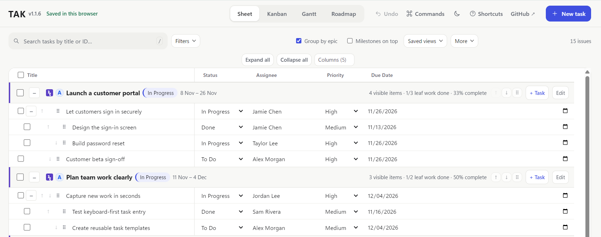
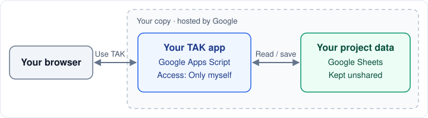

<div align="center">
<h1>TAK</h1>
<p><strong>A project tracker that runs on your own Google Sheet.</strong></p>
<p>Plan in a Sheet, Kanban board, Gantt timeline and Roadmap.<br/>
Google Sheets stores the data and Google Apps Script runs the app. There is no server to host and no new vendor to trust.</p>
<p>
<a href="https://martingrossman.github.io/TAK/"></a>
<a href="https://docs.google.com/spreadsheets/d/1HaBavwDoxemGXhrAPas_9ppTmRmHAHOlMc5NSjOJ2iE/copy"></a>
<a href="CHANGELOG.md"></a>

</p>
<p>
<a href="#getting-started">Getting started</a> ·
<a href="#features">Features</a> ·
<a href="#keyboard-shortcuts">Shortcuts</a> ·
<a href="#privacy">Privacy</a> ·
<a href="#development">Development</a>
</p>
<p><a href="https://martingrossman.github.io/TAK/#kanban"></a></p>
</div>

## Why TAK

Spreadsheets hold data well but are awkward for planning. Dedicated trackers plan well but keep your data in their database and usually charge per seat. TAK combines the two: a full planning interface on top of a spreadsheet that stays in your Google Drive.

- **You own the data.** Every task is a row in your Google Sheet. Filter, chart, share and export it with tools you already use.
- **Nothing to operate.** No server, database or extra account. Google runs the infrastructure; you control the access.
- **Private when you want it.** Copy the starter template, keep the Sheet unshared and deploy the app for **Only myself**.
- **One task list, four views.** Sheet, Kanban and Gantt work on the same tasks. Roadmap plans streams and milestones alongside them.
- **Fast capture.** Type a title and press Enter. `Prepare release @Martin 5d !high` sets the assignee, a five-day schedule and the priority in one line.
- **Keyboard-first, mouse-friendly.** `1`–`4` switch views, `/` searches, `T` and `S` add work, `Ctrl/Cmd+K` opens commands. Drag and drop works in every view.
- **Honest saving.** Every change shows **Saving**, **Saved**, **Failed** or **Conflict**. Revision checks prevent silent overwrites.

## Views

<table>
<tr>
<td width="50%" valign="top">
<p><strong>Sheet</strong><br/>Edit fields inline, sort, reparent and reorder.</p>
<a href="https://martingrossman.github.io/TAK/#sheet"></a>
</td>
<td width="50%" valign="top">
<p><strong>Kanban</strong><br/>Drag work between statuses, grouped by Epic.</p>
<a href="https://martingrossman.github.io/TAK/#kanban"></a>
</td>
</tr>
<tr>
<td width="50%" valign="top">
<p><strong>Gantt</strong><br/>Drag to reschedule, resize to set due dates.</p>
<a href="https://martingrossman.github.io/TAK/#gantt"></a>
</td>
<td width="50%" valign="top">
<p><strong>Roadmap</strong><br/>Plan increments and milestones across streams.</p>
<a href="https://martingrossman.github.io/TAK/#roadmap"></a>
</td>
</tr>
</table>

Select a screenshot to open that view in the demo. The demo needs no sign-in and keeps data in your browser only. Screenshots show a sample project and may differ slightly from the current interface.

## Getting started

| Goal | Option | Setup | Updates |
| :--- | :--- | :--- | :--- |
| Own both the spreadsheet and the app | [Starter template][starter] | Copy, authorize and deploy once | You update your copy |
| Use Google Sheets without deploying | [Hosted app][hosted] | Sign in, then create or select a Sheet | Maintained centrally |
| Explore the interface | [Browser demo][demo] | None | Data stays in this browser |
| Develop or test TAK | [Local preview](#development) | Node.js and a checkout | You rebuild from source |

<p align="center"></p>

<p align="center"><sub>Starter-template setup: you own the Sheet and the app; Google runs the infrastructure.</sub></p>

> [!NOTE]
> Demo and local-preview data never synchronize with Google Sheets or with each other. Each browser, device and site address keeps its own storage.

<a id="optional-full-screen-web-app"></a>

### Option A: your own app from the starter template

Own both the Sheet and its application. Use a desktop browser; setup takes about five minutes.

1. [Make a copy of the Tracker Template][starter] in your Google Drive.
2. Open **your copy**, refresh if needed, and choose **🔷 TAK → Open tracker**.
3. Review Google's permission request for your copied script. TAK prepares the Sheet and its edit trigger.
4. In **Finish your own TAK app**, select **Open Apps Script**, or use **Extensions → Apps Script**.
5. Choose **Deploy → New deployment**. Next to **Select type**, use the gear icon to choose **Web app**.
6. Set **Execute as: Me** and **Who has access: Only myself**, then select **Deploy** and complete authorization.
7. Return to your Sheet and choose **🔷 TAK → Open tracker** again. Your app opens in a new tab; bookmark its `/exec` address.

> [!TIP]
> The launcher guides you but does not create the deployment for you. Keep it owner-only. See Google's [web-app deployment guide](https://developers.google.com/apps-script/guides/web#deploy_a_script_as_a_web_app) and [bound-script ownership](https://developers.google.com/apps-script/guides/bound#access_to_bound_scripts): you own the copied script as well as the Sheet.

<details>
<summary><strong>Troubleshooting first run</strong></summary>
<br/>

| What you see | What to do |
| :--- | :--- |
| No **🔷 TAK** menu | Open your copy in a desktop browser, make sure you can edit it, then refresh the Sheet. |
| **Google hasn't verified this app** | Check that you are authorizing the script attached to the copy you created and that you trust its code. If you proceed, use **Advanced → Go to … (unsafe)** when available and review the permissions. A personal copy does not inherit another project's OAuth verification. See [Google's explanation](https://developers.google.com/apps-script/guides/client-verification). |
| **Finish your own TAK app** still appears | Complete the Web app deployment in this copy's script, then return to **Open tracker**. Saving source in the editor does not create a deployment. |
| No new browser tab opens | Select the **Open tracker ↗** link in the dialog. |
| An older copy reports insufficient trigger permissions | Its script may predate the corrected template. Test a fresh starter copy, or have its maintainer update and reauthorize it. Preserve your existing data. |
| A message says this copy points to another tracker | Stop before setup. Use a fresh starter copy; do not repoint or overwrite an existing tracker without checking its data. |

The personal template requests Google Sheets access, permission to show its dialog and permission to manage its edit trigger. This differs from the hosted app's file-selection permission; see [Privacy](#privacy).

</details>

### Option B: the hosted app

1. [Open the TAK web app][hosted] and sign in.
2. Choose **Create TAK Sheet with sample data**, **Create blank TAK Sheet** or **Select existing Google Sheet**.
3. For an existing tracker, select it in Google Picker to grant access.
4. Bookmark the app. Use **Switch Sheet** to connect another project.

The sample creates 13 items: 3 Epics, 3 Stories and 7 Tasks. The hosted app runs as the signed-in user with `drive.file`, so it can only open spreadsheets created through TAK or selected in Picker. To work as a team, share the Sheet and have each person select it in TAK; see the [sharing guide](docs/OPTION2_SHARING_GUIDE.md).

<details>
<summary><strong>Existing copies and updates</strong></summary>
<br/>

- **New starter copies** use the personal deployment flow introduced in `v1.1.6`.
- **Existing copies keep their attached code.** Updating the public template affects future copies only. Older copies may still open the central app or the earlier shared host.
- **Your own app** receives new code only when you update its script. Then use **Deploy → Manage deployments → Edit → New version → Deploy** to keep the existing `/exec` address.
- **Hosted-app users** receive centrally published updates when they reload.

A new starter copy is a separate tracker; it does not move data out of an older copy. For source-based administration, see [Install TAK from source](docs/INSTALL_FROM_SOURCE.md).

</details>

## Features

| View | Shortcut | Best for | Everyday actions |
| :--- | :---: | :--- | :--- |
| Sheet | `1` | Editing and comparing work | Edit cells, sort, change parents, reorder siblings, choose visible fields |
| Kanban | `2` | Moving work forward | Drag between statuses, group by Epic, collapse lanes, edit priority and assignee |
| Gantt | `3` | Planning task dates | Drag to reschedule, resize to set a due date, inspect progress and dependencies |
| Roadmap | `4` | Planning streams and milestones | Add increments, place milestones, adjust the period, rename and reschedule |

Sheet, Kanban and Gantt share the same tasks. Roadmap keeps its own streams, increments and milestones, separate from task records of type **Milestone**.

### Capture and organize

- **Title and Enter.** Use **+ Add task**, or focus an item and press `T` for a Task or `S` for a Story. The composer inherits context and stays open for the next title. `Esc` hides it and keeps the draft.
- **Details when needed.** **New task**, `N` or **Details** opens descriptions, dependencies and less common fields. Saved items show comments in the compact editor.
- **Reliable hierarchy.** Epics contain Stories; Tasks and Bugs nest where the parent rules allow. IDs stay stable when items move; self-parenting and cycles are rejected.
- **Saved views.** Search and filter by any property, then save the filters, sort, columns and collapse state (per browser).
- **Batch work.** **Paste list** previews up to 100 titles. Select items or **Shift+click** a range, then **Edit selected** or **Delete selected**. Hidden and pending items are excluded; deletion needs confirmation and has no general Undo.
- **CSV export.** Exports the filtered tasks and fields, with formula-like text neutralized. CSV import is not included.

### Quick entry

```text
Prepare release @Martin 5d !high
```

Creates **Prepare release**, assigned to **Martin**, scheduled for five working days, with **High** priority. Preview chips show what will be applied before you submit.

| Token | Meaning |
| :--- | :--- |
| `@Martin`, `@"Martin Novak"` | An assignee already used in the project |
| `!highest` `!high` `!medium` `!low` `!lowest` | Priority |
| `5d`, `2w` | Five or ten working days, including the start day |
| `due:today`, `due:tomorrow`, `due:2026-12-15` | An explicit deadline |

<details>
<summary><strong>Quick-entry rules</strong></summary>
<br/>

Workdays are Monday to Friday; holidays are not excluded. A duration moves a weekend start to Monday. Unknown tokens stay in the title; ambiguous or conflicting values need correction. Choose **Keep as title text** or prefix a token with a backslash, such as `\5d`, to keep it literal. Multiline paste does not interpret tokens.

</details>

<details>
<summary><strong>Moving work and planning dates</strong></summary>
<br/>

In Sheet, drag the dotted grip to a row's center to change its parent, or to its top or bottom quarter to insert before or after it under the same parent. An Epic heading accepts children; a **Drop here to remove parent** target appears during non-Epic drags. The Parent field remains available without dragging.

Up and down controls reorder siblings. Moving a row while a column sort is active returns Sheet to saved rank order. In Kanban, drop on a card to insert before it or on an empty column area to append; moving between Epic lanes also changes the parent.

New Tasks, Stories and Bugs default to today's start date. Explicit and cleared dates remain unchanged; Epic schedules follow their descendants. Gantt shows start-only tasks as compact bars: dragging keeps the empty due date, resizing sets one.

**Expand all**, **Collapse all** and each Epic's **+ / −** control fold work. Non-empty capture drafts are kept. Dependencies are validated links, not an automatic scheduler: moving a predecessor does not shift its successors.

</details>

### Roadmap

Drag the **Milestone** or **Increment** chip onto the grid and type a name, or select a chip to open the creation dialog. Select a name to rename it (`F2` also works); double-click, or press Enter on a focused item, for details.

Drag bars and milestones to reschedule or change streams, and drag a bar end to adjust its dates. **From**, **To**, the arrows and **This year** set the visible period. Milestone icons, colours and optional vertical lines make key dates easy to find.

Google-backed Roadmap data lives in a separate **Roadmap** tab, created on first save. The demo uses browser storage. A failed save restores the last saved item and shows a message.

The theme follows your system setting until you choose light or dark with the sun/moon button.

<details>
<summary><strong>Plan notepad and optional Gemini trial</strong></summary>
<br/>

**More → Plan notepad** plans several lines at once. Use `Epic:` headings and `Story:`, `Task:` or `Bug:` lines; choose an existing Epic or create one. Add `@Person`, `!high`, `+5d` or `+2w`. Preview, correct and select the proposed items before applying them.

**Prepare for Gemini** downloads your notes and a complete issue snapshot. Upload it to Gemini yourself, copy the supplied prompt, then paste the proposed JSON back into TAK for review. Exported fields include descriptions, assignees and dependencies; comments, history, settings and spreadsheet identity are omitted. Preparing the download does not send it anywhere.

The optional **Ask Gemini API** trial needs a separately configured private installation, a `GEMINI_API_KEY` in Script Properties and external-request permission, which the standard hosted and template manifests do not include. A configured request sends project context to Gemini and may incur charges; proposals still need review. See the [trial verification notes](TESTING.md#private-gemini-api-trial).

</details>

## Keyboard shortcuts

Use `Ctrl` on Windows and Linux, `Cmd` on macOS. Single-key shortcuts pause while typing, during IME composition and in dialogs, and can be turned off under **Shortcuts**.

| Key | Action |
| :--- | :--- |
| `T` / `S` | Quick Task / Story in the focused context |
| `Shift+T` / `Shift+S` | Task / Story in the compact editor |
| `N` | New issue dialog |
| `E` / `X` | Edit / select the focused issue |
| `P` / `A` / `M` / `D` | Edit priority / assignee / status / due date |
| `/` | Search |
| `1` `2` `3` `4` | Sheet / Kanban / Gantt / Roadmap |
| `Ctrl/Cmd+K` | Commands |
| `Alt` + arrows | Move a focused Roadmap item by a day or between streams; `Shift` steps by a week |

<details>
<summary><strong>Full editing and navigation reference</strong></summary>
<br/>

| Where / focus | Key | Action |
| :--- | :--- | :--- |
| Quick-add title, including Kanban column entry | `Enter` | Submit and leave an empty, focused composer ready for another title; Esc closes it. |
| Quick-add title | `Shift+Enter` | Submit and leave an empty, focused composer ready for another title. |
| Ghost Capture, from any control | `Esc` | Hide capture, retain the unfinished draft, and restore originating focus. Discard draft is a secondary action. |
| Focused row grip, card or Gantt label | `↑` / `↓` | Navigate visible items; Kanban `←` / `→` changes column without changing data. |
| Issue dialog title | `Enter` | Submit the issue form. |
| Issue dialog | `Ctrl/Cmd+Enter` | Submit the issue form, including from the description. |
| Issue dialog | `Tab` / `Shift+Tab` | Move forward/backward through controls within the dialog. |
| Issue dialog | `Esc` | Request closing; unsaved changes may require confirmation. |
| Sheet editable cell | `Tab` / `Shift+Tab` | Commit the cell change and move to the next/previous editable cell. |
| Sheet text, number, or date input | `Enter` / `Shift+Enter` | Commit the change and move down/up in the same column. |
| Sheet text, number, or date input | `Esc` | Cancel the unsent edit and focus the row grip; T/S is then available. |
| Kanban assignee input | `Enter` / `Esc` | Submit the assignee change / cancel the unsent change. |
| Focused Kanban card | `Enter` or `Space` | Open the issue editor. |
| Focused Kanban card | `Alt+↑` / `Alt+↓` | Reorder the card within its current column and lane. |
| Focused Kanban card | `Alt+←` / `Alt+→` | Move to the previous/next status column, keeping its parent. |
| Sheet dotted row grip | `Alt+↑` / `Alt+↓` | Reorder siblings while keeping the same parent. |
| Gantt task label or bar | `Enter` or `Space` | Open the issue editor. |
| Gantt task label or Epic lane heading | `Alt+↑` / `Alt+↓` | Reorder siblings. |
| Gantt task label | `Alt+←` / `Alt+→` | Remove the parent / nest under the previous sibling when that relationship is valid. |
| Gantt label/timeline divider | `←` / `→` | Narrow/widen the label area by 10 pixels. |
| Commands search | `Enter` / `↓` | Run the first result / focus the first result. |
| Focused Commands result | `↑` / `↓` | Move between results; Up from the first returns to search. |
| Commands dialog | `Esc` | Close Commands and restore focus. |

Use `Tab` to reach cards, row grips, task labels and other controls before applying their shortcuts. **Commands** also opens with mouse or touch. **Shortcuts** starts with five capture actions (T, S, Enter, Shift+Enter, Esc); expand the other groups for everything else, including the single-key preference.

</details>

## Saving and collaboration

New work appears immediately as **Saving…** or **Queued…**; treat it as saved only once confirmed. A failed quick-add stays available for retry. Pending items cannot yet be edited, dragged or used as parents.

- **Conflict detection.** Task edits use revision checks. On a conflict, **Compare with latest** shows the difference. Changes are never silently overwritten or merged automatically.
- **Undo** covers acknowledged edits, moves, scheduling, bulk edits and duplication, subject to revision checks. It does not recover deletions, creations or comments.
- **Refresh, not live co-editing.** In team mode the app refreshes periodically while visible and idle, or on **Refresh**. Direct Sheet edits do not take the app's script lock, so avoid editing the same row through both at the same moment.

| Setup | Collaboration |
| :--- | :--- |
| Hosted app | Share the Sheet in Google; each teammate selects it through Picker |
| Personal template deployed as **Only myself** | Owner-only app; sharing the Sheet does not change app access |
| Browser demo or local preview | Local to that browser and address |

Google-backed saves can take several seconds. Response-time goals in the [MVP requirements](docs/PRODUCT_REQUIREMENTS_MVP.md) are targets, not guarantees. Reliability follow-ups are tracked in the [backlog](docs/BACKLOG.md).

<details>
<summary><strong>Personal mode and advanced storage</strong></summary>
<br/>

A private installation can run `enablePersonalTrackerMode` to disable detailed history and automatic polling; `enableTeamTrackerMode` restores them. These change server behaviour, not Google sharing. The optimized personal save path also needs the Advanced Sheets service, which the standard starter template does not enable.

Normal template use needs no schema migration. The legacy `Issues` layout and the optional v2 `Tasks` / `Projects and Epics` layout are distinct storage paths. V2 activation, rollback and authorization configuration require a backed-up test workbook and the [administration guide](docs/INSTALL_FROM_SOURCE.md).

</details>

## Sheet structure

Tasks live in the **Issues** tab. Keep its header names and order intact; the app's **Title** is the Sheet's **Summary** column. TAK manages IDs, revision timestamps and ordering.

Template copies install an edit trigger during setup, so direct Sheet edits receive defaults and validation. Enter a Summary in column D and fill in the rest. Dates are stored as Sheet dates. Roadmap items use their own tab.

<details>
<summary><strong>All 21 task columns</strong></summary>
<br/>

| Column | Field | Meaning |
| :--- | :--- | :--- |
| A | ID | Generated `PRJ-1`, `PRJ-2`, etc. |
| B | Type | Epic, Story, Task, Bug, Milestone |
| C | Parent ID | Optional parent issue ID |
| D | Summary | Required, up to 250 characters in the app |
| E | Description | Context, acceptance criteria, and links as text |
| F | Status | Backlog, To Do, In Progress, Review, Done |
| G | Priority | Highest, High, Medium, Low, Lowest |
| H | Assignee | Name or email; blank means unassigned |
| I | Reporter | Name or email |
| J | Start Date | Optional date, displayed as YYYY-MM-DD |
| K | Due Date | Optional date, on or after start |
| L | Completed Date | Generated when moving to Done; cleared on reopening |
| M | Estimate (h) | Nonnegative hours |
| N | Time Spent (h) | Nonnegative hours |
| O | Progress (%) | 0–100; Done sets 100; reopening a completed issue resets 100 to 0 |
| P | Labels | Comma-separated text |
| Q | Sprint | Optional sprint name |
| R | Dependencies | Comma-separated existing issue IDs; cycles prohibited in the app |
| S | Created At | Generated timestamp |
| T | Updated At | Generated timestamp |
| U | Order | Numeric board sort order; normally managed by the app |

</details>

## Privacy

A starter-template copy can be fully private: keep the Sheet unshared and deploy the app with **Who has access: Only myself**. Sheet sharing and app access are separate settings, so check both. Google hosts the Sheet and the app; you control who can reach them.

| Where you use TAK | Data and permissions |
| :--- | :--- |
| Browser demo or local preview | Tasks and preferences stay in this browser's `localStorage` for that address |
| Hosted app | Tasks are in your Sheet; `drive.file` limits access to files created through TAK or selected in Picker |
| Your template copy | Tasks are in the copied Sheet. The script requests `spreadsheets` access, `script.container.ui` for dialogs and `script.scriptapp` for triggers |

Google-backed use also keeps UI preferences and recovery drafts in the browser. Owning a copy does not limit its OAuth grant to one spreadsheet; review the Sheets permission when you authorize it.

TAK has no third-party task database. If you upload a planning export to Gemini, or configure the Gemini API trial, that task content is shared with Gemini; review it first.

Contact: [martin.grossman@gmail.com](mailto:martin.grossman@gmail.com)

## Development

Requires **Node.js 20+**. The app is plain HTML, CSS and JavaScript with no runtime dependencies, framework or bundler.

```sh
git clone --branch implement_mvp https://github.com/martingrossman/TAK.git
cd TAK
npm ci
npm run build
npm start
```

Then open <http://127.0.0.1:4180>. On Windows PowerShell, use `npm.cmd` if script policy blocks `npm`. Set `PORT` to change the port. You can also open `dist/index.html` directly or serve it from any HTTPS static host. Browser storage is not a backup; export CSV when needed.

| Command | Purpose |
| :--- | :--- |
| `npm run build` | Generate `src/CoreScript.html`, `src/Version.js` and `dist/index.html`; validate JavaScript |
| `npm test` | Run Node tests |
| `npm run check` | Build and run Node tests |
| `npm run test:browser` | Run Playwright tests in Microsoft Edge |
| `npm start` | Serve the preview on port 4180 |
| `npm run stop` | Stop the preview server |

Direct view links use `#sheet`, `#kanban`, `#gantt` and `#roadmap`, or the equivalent `?view=…`.

### Testing

`npm run check` validates the build and exercises model, storage, setup, conflict and recovery behavior with local fixtures. For browser tests, install Edge with `npx playwright install msedge` and run the relevant specs from [TESTING.md](TESTING.md). Playwright uses a local server on port 4587 (override with `SHEETFLOW_TEST_PORT`) and keeps traces on failure.

Local tests do not cover Google authorization, live deployments or real Sheet permissions. Verify those on a disposable test copy.

### Architecture

One model and interface serve both browser storage and Google Sheets; there is no separate TAK database. Sheet, Kanban and Gantt read the same issue collection, and Roadmap keeps its own plan.

<details>
<summary><strong>Source map</strong></summary>
<br/>

| Files | Responsibility |
| :--- | :--- |
| `src/Index.html`, `src/Styles.html`, `src/Client.html` | Interface, views, interactions and browser persistence |
| `src/Core.js` | Shared model, validation, dates, CSV and sample data |
| `src/Code.js`, `src/PersonalBatch.js` | Apps Script entry points, Sheets access, setup and saves |
| `src/FullScreen.html`, `src/Help.html`, `src/QuickAdd.html` | Sheet launcher, help and quick-add dialogs |
| `src/SharedHost.js`, `src/Connection.html` | Earlier shared-host mode and connection helpers |
| `src/Roadmap.js` | Roadmap storage and revision checks |
| `src/Schema.js`, `src/Migrations.js`, `src/Environment.js`, `src/Repository.js` | Schema, environment selection and optional v2 storage |
| `src/Authorization.js`, `src/Settings.js`, `src/History.js`, `src/Ordering.js`, `src/Comments.js` | Access checks, settings, history, ordering and comments |
| `scripts/build.mjs` | Generate browser and version outputs |
| `scripts/google-package.mjs`, `scripts/stage-package.mjs` | Package the personal template or earlier shared host |
| `scripts/release.mjs`, `scripts/clasp-info.mjs` | Human-run release helper and deployment information |
| `tests/`, `e2e/` | Node fixtures and browser tests |

`src/CoreScript.html`, `src/Version.js` and `dist/index.html` are generated; edit their sources and rebuild.

</details>

TAK keeps `sheetflow.` browser keys, `SHEETFLOW_` properties and `SheetFlow` namespaces for compatibility. It is a standalone tracker, not a Jira integration.

### Releases

<details>
<summary><strong>Publishing and update targets</strong></summary>
<br/>

Every web app release also updates the starter template's script to the same version. Existing user copies keep their own code.

| Destination | What a release updates |
| :--- | :--- |
| GitHub Pages | The browser demo; its workflow runs on pushes to `implement_mvp` |
| Hosted web app | The version behind its existing `/exec` URL |
| Public starter template | Code inherited by **future** copies |
| An existing personal copy | Only when its owner installs code and updates that copy's deployment |

Maintainers follow [docs/RELEASE.md](docs/RELEASE.md): build and test, version and document the change, test `/dev`, obtain the owner's production approval, update the existing deployment, then update the public template and verify a fresh copy.

The repository root is the hosted app's clasp project; runtime files live in `src/`. Template code and its permissions are packaged with `node scripts/stage-package.mjs template`. Verify the destination project before any upload.

`npm run release` is for a person at an interactive terminal; `npm run clasp:info` reads deployment information. Git publication, GitHub Pages and Apps Script deployment are separate actions. The version lives in `package.json`; the build generates the header badge and `src/Version.js`.

</details>

## Documentation

| Document | Contents |
| :--- | :--- |
| [Changelog](CHANGELOG.md) | Changes by version |
| [Testing guide](TESTING.md) | Targeted checks and recorded results |
| [Sharing guide](docs/OPTION2_SHARING_GUIDE.md) | Google Picker and team access for the hosted app |
| [Install from source](docs/INSTALL_FROM_SOURCE.md) | Advanced administration |
| [Release guide](docs/RELEASE.md) | Production, template updates and rollback |
| [MVP requirements](docs/PRODUCT_REQUIREMENTS_MVP.md) · [UX specification](docs/UI_UX_DESIGN_SPEC.md) · [Future roadmap](docs/FUTURE_ROADMAP.md) | Product contracts and planned work |
| [Shared-host design](docs/SHARED_APP_DESIGN.md) | Historical architecture used by some older copies |

[demo]: https://martingrossman.github.io/TAK/
[starter]: https://docs.google.com/spreadsheets/d/1HaBavwDoxemGXhrAPas_9ppTmRmHAHOlMc5NSjOJ2iE/copy
[hosted]: https://script.google.com/macros/s/AKfycbzVyzDi_IaUvTDZGazF8k4nEcWxzdu5idr8oTrXveV8B7cQ9Af_uSszXcXelkBxb5r_/exec
